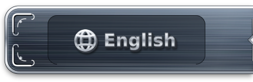
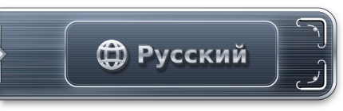

<p align="center"><a href="README.md"></a><a href="README.ru.md"></a></p>

# Scout Bot 🤖

🔭 **Scout Bot** — бот-разведчик, который сканирует **публичные** репозитории GitHub, отбирает проекты, близкие интересам Velantrim (🧠 ИИ-память, 🕸️ графы знаний, 💻 local-first, 🌍 open source), и готовит предложения о сотрудничестве.

> ⚠️ Scout Bot ничего не отправляет сам. Каждое предложение уходит только после явного «да» пользователя на конкретный текст.

## 📁 Структура репозитория

```
scout-bot/
├── scanner/     # 🔎 чтение публичного GitHub, только чтение
├── filters/     # 🧹 фильтры отбора и оценка
├── templates/   # 📝 шаблоны карточки утверждения и сообщения
├── consent/     # 🚦 механизм явного подтверждения, журнал, список отказов
└── config/      # ⚙️ веса, лимиты, темы; без токенов
```

## 🛠️ Как это работает

1. 🔎 **Поиск** — находим публичные репозитории по темам интересов.
2. 🧹 **Фильтры** — отсеиваем неподходящие (лицензия, архив, форк, пометка «не писать», уже контактировали, список отказов).
3. 📊 **Оценка** — ранжируем оставшиеся по релевантности и активности.
4. 📂 **Досье** — собираем факты о проекте, каждый со ссылкой на источник.
5. ✍️ **Черновик** — готовим карточку «Что найдено / Что предлагаем» и текст сообщения.
6. ✅ **Утверждение пользователем** — пользователь читает конкретный текст и явно говорит «да» или «нет».
7. 📤 **Отправка самим пользователем** — сообщение отправляет пользователь, не бот.
8. 🗃️ **Учёт ответов и отказов** — фиксируем результат; отказ вносится в список отказов.

## 🚦 Принцип явного подтверждения

- ✅ Каждое предложение уходит только после явного «да» пользователя на конкретный текст.
- 🚫 Нет автосогласия.
- 🚫 Нет пакетного одобрения.
- ✏️ Правка текста = новое одобрение.
- ⏳ Одобрение действует 7 дней.
- 🔒 У бота нет права отправки.
- 🛑 Отказы соблюдаются навсегда.
- 📭 Email из коммитов и профилей не собирается; сначала Issues или Discussions проекта.

## 📌 Статус

🚧 **В разработке** — дизайн, реализация не начата.

- RESEARCH ≠ IMPLEMENTATION
- IMPLEMENTED ≠ ACTIVATED

Описанное выше — проектные принципы, а не работающие функции.
